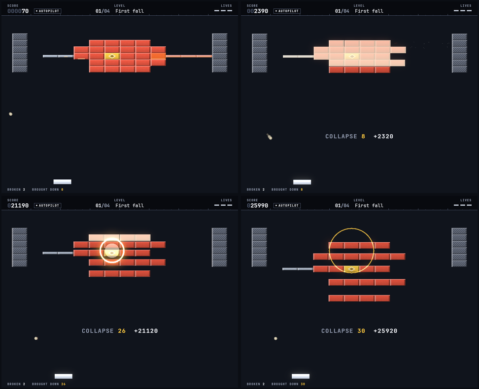

# Structural gameplay

How structural destruction works in BRYX: the model, the rules, what the
simulation emits and what the player sees and hears. The idea behind it is
in [`../concept.md`](../concept.md).

Status: playable. 32 levels in four acts (`levels::STRUCTURES`), their own
menu row (Structures) and flag (`--structures`), both renderers, the
sound director, the HUD, the autopilot and the playtest log. The campaign
is not converted yet (see "Next").



*First fall, played by the autopilot. One beam is cut (top left: the
beams and the brick on the other side glow as they crack); they give way
and the block turns white, about to fall; it lets go row by row from the
bottom; the keystone's fall ends the level.*

## 1. The model

A structure is a graph on the level's grid (`src/structure.rs`). Nothing
in it is a physics body.

| Term | Meaning |
|---|---|
| Anchor | An indestructible brick (`X`). Fixed to the world. |
| Bond | Two bricks whose cells share an edge hold each other. A beam bonds only left and right, a tie only up and down. |
| Held | A chain of bonds leads from the brick to an anchor. |
| Load | The number of bricks that would stop being held if this brick alone were gone. |
| Capacity | How many bricks a brick can carry: by kind, and by the hits it has left. |

Two consequences worth stating, because levels are built on them:

- **Two holds share, and neither carries.** A block held from both sides
  has no brick whose loss drops it, so every load in it is zero. Cut one
  side and the other side's bricks each carry the whole block.
- **A neck forms wherever the ball makes one.** Any brick left as the only
  link to a section carries that section. A normal brick carries four, so
  a section of five or more hanging by one normal brick comes down by
  itself. Collapses are not limited to the bricks a level's author marked.

### Brick kinds

| Kind | Char | Hits | Carries | Notes |
|---|---|---|---|---|
| Normal | `1` | 1 | 4 | |
| Armored | `2` | 2 | 3 per hit left | Tough, not strong. |
| Support | `S` | 2 | 6 per hit left | A cracked support holds half. |
| Beam | `=` | 1 | 6 | 52×8 px. Bonds left and right only. |
| Tie | `\|` | 1 | 6 | 10×22 px. Bonds up and down only. |
| Keystone | `K` | none | no limit | Nothing that strikes it breaks it. |
| Anchor | `X` | none | no limit | Steel. |

The numbers live in one table, `structure::RULES`, with the timings
below. Balancing is a change to that table.

## 2. The lifecycle

```
Intact ─▶ Stressed ─▶ Overloaded ─▶ gives way ─▶ destroyed
                          │
   (what it held) ────────┴─▶ Unstable ─▶ falling ─▶ lands or leaves
```

| State | When | What happens | Shown as |
|---|---|---|---|
| Intact | Held, carrying half its capacity or less | Nothing | A load mark if it carries anything |
| Stressed | Held, carrying more than half | Nothing yet | A longer load mark |
| Overloaded | Carrying more than its capacity | Cracks for 0.8 s, then gives way (breaks where it stands) | A full mark and an orange glow that strengthens and beats faster |
| Unstable | No chain to an anchor | Shakes for 0.3 s, then lets go; each row above the lowest 0.05 s later | White-hot, shaking |
| Falling | Let go | Falls straight down at 1500 px/s², up to 640 px/s | The brick, dimmed |
| Landed | It meets a standing brick | It shatters; the brick it hit takes one hit | Dust, and the hit brick's crack or break |
| On the paddle | It meets the paddle, before the keystone is down | It shatters; the paddle cannot move for 0.75 s | Sparks, the paddle in the overload's orange |

The rows of a section let go bottom-up, so it peels away and no falling
brick overtakes another.

### What is deterministic, and what bounds it

- The graph is surveyed only when the number of bricks changes (bricks
  only ever leave a level), never per tick or per frame.
- One survey floods the grid once for the held set and once per brick
  with two bonds or more for its load: at most 196 floods of 196 cells,
  on arrays on the stack.
- A cascade advances one step a tick. A brick that goes this tick is seen
  by the next tick's survey. There is no recursion and no event that
  triggers another within a tick.
- No randomness: a brick brought down rolls no power-up, and nothing in
  the structure reads a generator.
- Timings accumulate the fixed tick, so they are the same on every
  machine and at every frame rate.

`game.rs` has the tests: the same cut gives the same events and score; a
vault broken at random, forty times, never rests with a brick hanging on
nothing or over its limit.

## 3. The keystone and the end of a level

- A ball, a bolt, a blast, a meteorite and a falling brick all leave the
  keystone whole. A ball bounces off it, metal or not.
- It is not an anchor. A level may not put one beside an anchor (tested):
  it could never fall.
- When it lets go, `KeystoneFell` is emitted, the level is won and every
  brick still standing lets go after it.
- While that finale runs the balls hold still, so the level's last second
  cannot cost a life. The level ends when nothing is left standing or
  falling.
- A level is over, in general, when no brick but steel remains and
  nothing is falling. Breaking everything around the keystone therefore
  also wins.

## 4. Interactions with the rest of the game

| Case | Behaviour |
|---|---|
| Multiball | Every ball breaks bricks as usual; the structure reacts to the bricks, not to who broke them. |
| Explosive ball | The blast breaks what it reaches; the keystone and steel are untouched. A blast can cut several holds at once. |
| Metal ball | Flies through breakable bricks; turned back by steel and by the keystone. |
| Lasers, meteorites | Break bricks as elsewhere; stopped by steel and by the keystone. |
| Simultaneous impacts | Bricks broken in one tick are surveyed together on the next. |
| A life lost during a collapse | The collapse goes on while the next ball waits on the paddle. |
| The level ends during a cascade | It ends when the last debris has landed or left, not before. |
| Break gate | Off in this mode (the capsule never drops): a structure is a problem to solve, and a way around it is not a solution. |
| Asteroids | Off in this mode: the field's moving parts are the bricks coming down. |
| Stall rule | Unchanged. A keystone hit is not progress, so a ball caught between steel and a keystone is still turned out. |

### The paddle under a collapse

A falling brick that lands on the paddle shatters on it and holds the
paddle where it stands for `stun_secs` (0.75 s). A second one starts the
time over; it is not added. The ball is still in flight, so the cost is
whatever the paddle could not reach meanwhile.

- **It is announced.** Both renderers draw a bar on the paddle's line
  under every brick that will come down on it (`Game::fall_zones`): pale
  while the brick still shakes in place, orange once it is in the air. A
  brick that a standing brick will catch shows none. From losing its hold
  to reaching the paddle a brick takes over a second.
- **It ends with the level.** Once the keystone is down nothing that
  falls touches the paddle: the level is won, the balls hold still, and
  the collapse is the reward, not a last trap. A lost life and a new
  level free a held paddle.
- **It does not score.** No points are lost; time and the ball are.

So it bites on the collapses that are steps, not the one that wins: a
section cut loose on the way to the keystone, a neck that gave way, a
roof dropped to crack what is under it. The plan now has a second
question: where will this land, and where will the ball be then?

## 5. Scoring

- A brick the ball breaks scores as with rally scoring: its row's value
  times its place in the rally, ×1 to ×10.
- A brick brought down (it fell, was crushed, or gave way) scores
  `collapse_factor` (2) times that, and is one more brick of the rally.
- The keystone is worth 250 before the multipliers.
- When the keystone falls, everything left is brought down and scored as
  such. Finishing early, with the structure standing, therefore pays more
  than chipping it away first.
- No score accrues with time. The mode has no asteroids, so nothing pays
  for keeping the ball up.

The HUD shows the tally of the level (broken, brought down) and each
collapse of two bricks or more, as it runs and for 1.6 s after.

This mode always scores by the rally and keeps one record, apart from the
campaign's.

## 6. Events

Added to `GameEvent`; the simulation emits them, and nothing reads them
back.

| Event | When |
|---|---|
| `BrickOverloaded { rect, load, capacity }` | A brick starts carrying more than it can |
| `BrickGaveWay { rect }` | It breaks under it; its `BrickDestroyedAt` follows |
| `SupportLost { x, y, dependents }` | A brick that carried others is gone |
| `SectionUnstable { count, x, y }` | Bricks lost their hold |
| `BrickFell { rect, kind, nth }` | A brick let go; scored now, no `BrickDestroyedAt` |
| `DebrisLanded { x, y }` | A falling brick landed; the hit brick's `BrickStruck` (by `Striker::Debris`) follows |
| `PaddleStruck { x, y }` | A falling brick landed on the paddle |
| `KeystoneFell { x, y }` | The level is won |
| `CollapseEnded { bricks, score }` | Nothing cracks, shakes or falls any more |

`rally.rs` counts a `BrickFell` as it counts a `BrickDestroyedAt`, so the
scored rally, the note and the light still agree (a property test holds
them together over the structures too).

## 7. Sound

Played on the existing cues, pitched in the playing track's scale
(`audio/director.rs`). No new sample.

| Event | Sound |
|---|---|
| A brick broken by the ball | The rally note, one step up the scale (as before) |
| Overloaded | The armor's crack an octave down, quiet: tension |
| Gives way | A short accent a semitone over the root, the one note out of key |
| Support lost | A bass note off the root, louder the more it carried |
| A row lets go | One note, down the scale from its top: a collapse descends where the rally climbs |
| A falling brick lands | The steel knock, lower |
| A falling brick lands on the paddle | The steel knock an octave down, loud, with the armor's crack |
| Keystone falls | The root and its octave: the resolution; the level fanfare follows |
| A collapse of eight or more ends | A low boom, unless the fanfare ends it |

Each sounds once a tick at most, however many bricks do it together.

Known limit: the rally scale is the track's, but the accent and the boom
are fixed intervals, and the pentatonic over the harmonic-minor tracks is
as it was. Dedicated voices belong with the studio score (PR #34), which
replaces the cue set this is written against.

## 8. Look

One function, `palette::structure_look`, reads a brick's state and both
renderers draw what it returns, so 2D and 3D say the same thing.

- **Load mark:** a bar along the brick's lower edge (its near edge in
  3D), as long as its share of its limit. No bar: it carries nothing.
- **Overloaded:** orange over the brick, strengthening, beating from 3 to
  9 Hz.
- **Unstable:** white-hot, shaking 1.5 px.
- **Falling:** the brick at four fifths of its light; in 3D it tips
  forward as it gathers speed.
- **Where it will land:** a bar on the paddle's line, pale then orange
  (above).
- **A struck paddle:** the overload's orange, easing as it comes free.
- **Reduced motion:** nothing shakes, beats or tips. The glow alone says
  it, steady.

Effects are restrained: a fall has none (the brick is the effect), a
landing throws four sparks, and only the keystone gets the blast's core
and ring.

## 9. The 32 levels

As many as the campaign, in four acts of eight. The first two are
lessons: one cut and the structure comes down. From the third on, no
single brick brings the keystone down, so a level is a sequence of cuts,
and which comes first matters. Each act ends on one of the larger
structures: the Crane, the Bridge, the Gantry, the Citadel.

Eight of them were built and played first (First fall, Table, Tower,
Arch, Bridge, Vault, Gantry, Citadel). The other 24 are a first pass:
checked by the tests and the autopilot below, not yet played by a person
or looked at one by one on screen.

All are original. The shapes some take (an eye, a flower, a face, a
lattice) are the kind brick-breaker levels have always drawn; none is
copied from another game or from a fetched levelset.

| # | Act | Level | Its lesson, as the serve prompt says it | Hold (hits) |
|---|---|---|---|---|
| 1 | I | First fall | Cut a beam | 2 |
| 2 | I | Table | Break a leg | 2 |
| 3 | I | Pendulum | Both ties | 2 |
| 4 | I | Chandelier | Two of three holds | 3 |
| 5 | I | Tower | Cut it low | 4 |
| 6 | I | Portcullis | Two hangers | 3 |
| 7 | I | Arch | Weaken what is left | 4 |
| 8 | I | Crane | Crack the last hanger | 2 |
| 9 | II | Lantern | Cut two ties | 3 |
| 10 | II | Kite | Cut the strings | 3 |
| 11 | II | Aqueduct | Free the middle span | 5 |
| 12 | II | Mobile | Under the ties | 2 |
| 13 | II | Eye | Two of three | 3 |
| 14 | II | Hourglass | Clear the waist | 4 |
| 15 | II | Scales | One hold, then crack it | 4 |
| 16 | II | Bridge | Drop the slab whole | 4 |
| 17 | III | Pagoda | Both sides of it | 4 |
| 18 | III | Flower | Stem, then crack | 4 |
| 19 | III | Windmill | Three of four | 4 |
| 20 | III | Ladder | The middle rung | 4 |
| 21 | III | Scaffold | Cut it low | 4 |
| 22 | III | Spider | Its belly, then its back | 4 |
| 23 | III | Vault | Keep it heavy | 6 |
| 24 | III | Gantry | Two of three | 6 |
| 25 | IV | Crown | Two of three | 6 |
| 26 | IV | Mask | Through the mouth | 6 |
| 27 | IV | Saucer | Two hangers | 6 |
| 28 | IV | Lattice | Four threads | 4 |
| 29 | IV | Drawbridge | The chain and the deck | 4 |
| 30 | IV | Keep | Breach the curtain | 6 |
| 31 | IV | Reactor | In through the slots | 8 |
| 32 | IV | Citadel | Bring it all down | 6 |

Each is checked by `game.rs`: all of it holds at the start, nothing starts
over its limit, one keystone, no anchor beside it.

### How hard, measured

Two numbers a test computes for every level
(`the_structures_get_harder_and_past_the_second_none_falls_to_one_brick`),
and one from the autopilot:

- **Hold:** the hits it takes to cut every chain from the keystone to an
  anchor (`Structure::keystone_holds`, a minimum cut). An upper bound on
  the work: a structure often comes down for less, when a cut leaves a
  hold carrying more than it can. Its mean by act: 3e+00, 4e+00,
  4e+00, 6e+00.
- **One brick wins:** whether breaking a single brick, however many hits
  it takes, ends the level. True of the first two levels only, found by
  playing every brick of every level out.
- **Autopilot:** it brings all 32 down on each of three seeds, in 24 to
  25 minutes of play, struck by falling bricks 4 to 11 times
  (`the_heuristic_brings_down_every_structure`, ignored by default: a few
  seconds in release). A pacing probe, not a measure of how hard a person
  finds them.

Writing the levels against these checks caught six that were wrong as
first drawn. Five fell to one brick: a neck of plain bricks tore under
what hung from it, or a post carried more than it could. One had a jaw
attached to nothing. And one of the five, once fixed, took the autopilot
sixteen minutes to reach its hanger, and was redrawn.

What makes a level harder, in order of effect:

1. **More holds than one cut removes.** Three ties, three hangers, four
   holds on a cage: a structure that stands on any two.
2. **Holds strong enough to carry it alone.** A support carries twelve.
   Where the last hold can carry the structure, the player has to crack
   it, or leave more weight hanging on it.
3. **Steel in the way.** A deck no ball reaches from below; hangers in a
   gap entered from the sides; a chamber entered over its walls or
   through two slots in its floor.
4. **No way around.** The Break gate is off in this mode.

## 10. Decisions, and what I did not do

- **The keystone cannot be struck.** The brief asked for a keystone
  "exposed" by destruction. An unbreakable one is the stronger form of
  that: a level cannot be finished without bringing something down, and
  never ends on a hunt.
- **Supports are a kind, load is computed.** The brief listed four
  authored roles. Any brick can end up carrying others, so load is worked
  out from the graph and drawn; the support is the kind built to carry it.
- **No physics engine.** Falling straight down, one hit on landing. It is
  enough for a cascade to cross from one structure to another, and it
  stays exactly reproducible.
- **Stress does not spread from an impact.** A hit weakens what it hits
  (a cracked support carries half); load then does the rest. A second
  channel of "stress" travelling through bonds would be harder to predict
  and to draw, for no decision it adds.
- **A new mode, not a converted campaign.** The campaign's 32 flat walls
  have no anchors; converting them one for one would make 32 identical
  dependency graphs.

## 11. Known limits

- **Difficulty is measured, not felt.** The numbers above say the levels
  ask for more as the acts go on; the order inside an act is a first
  guess. Whether a level is hard or merely slow is for the playtest.
- **The 24 newer levels are a first pass** (above): correct by the rules,
  winnable by the autopilot, unplayed.
- **The autopilot rarely loses a life here.** It aims exactly and
  returns nearly every ball. Its times say little about the pressure a
  person is under.
- **The hazard is occasional for a precise player.** Over the 32 levels
  the autopilot, which steps aside, is struck 4 to 11 times a run (three
  seeds). Most bricks fall with the keystone, when nothing can touch the
  paddle. A player who chips, and so cuts more sections loose on the way,
  will meet it more; how much is for the playtest.
- **Capsules can shortcut a level.** A Super laser, a Metal ball or a
  Meteor rain cuts holds faster than any shot. They drop only from bricks
  the ball breaks, so they are rare here; they are not tuned for this
  mode.
- **The autopilot's forecast ignores collapse.** It predicts the ball
  against the bricks as they stand; after a section falls the forecast is
  recomputed, so it is late by one bounce, never wrong for long.
- **`what_falls` undercounts.** It follows overloads and lost holds, not
  what falling bricks would crush.
- **Score scale.** A structure pays tens of thousands; the campaign pays
  about two thousand a level. The records are separate, and the numbers
  are untuned.
- **Sound** uses the existing cues (above).

## 12. Next

1. **Human playtest** of the levels, the first act above all (`docs/playtest.md`): time to
   the first fall, bricks brought down against broken, whether supports
   are aimed at, and where players stall.
2. **More of the hazard, if the playtest asks for it.** Two ways, in
   this order: levels with more to bring down before the keystone (the
   hazard as built, met more often); then a reason to get clear of the
   winning collapse too, as a bonus for an untouched paddle, never as a
   life.
3. **Act I rebuilt on structures**, eight levels, teaching one idea each;
   then the other acts (moving anchors for Machines, armored supports for
   the Vault).
4. **Dedicated collapse voices** once the studio score has merged.
